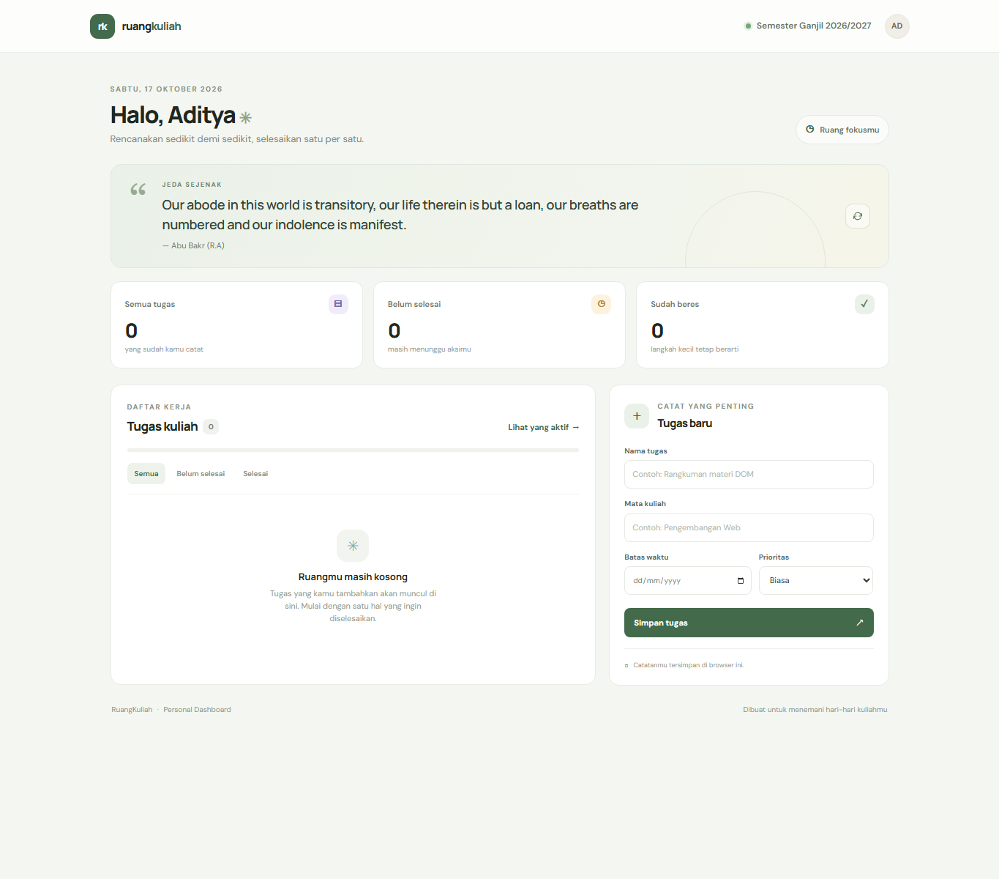

# RuangKuliah — Personal Dashboard

## Identitas

- **Nama Lengkap:** Muhammad Aditya Dhani Putra
- **NIM:** 124140041
- **Kelas Praktikum:** RA
- **Pertemuan:** 2 — JavaScript Next Gen (ES6+)

## Deskripsi Aplikasi

RuangKuliah adalah dashboard sederhana untuk mencatat dan mengatur tugas kuliah. Setiap tugas dapat diberi mata kuliah, batas waktu, dan prioritas. Daftar tugas disimpan di browser sehingga tetap tersedia saat halaman dibuka kembali.

Dashboard juga menampilkan ringkasan progres dan kutipan singkat yang dimuat dari DummyJSON. Jika koneksi internet tidak tersedia, aplikasi memakai kutipan cadangan.

## Fitur

- Menambah, mengedit, menghapus, dan menandai tugas selesai
- Mencatat mata kuliah, tenggat, dan prioritas tugas
- Filter semua tugas, tugas aktif, dan tugas selesai
- Ringkasan jumlah tugas dan progres penyelesaian
- Penyimpanan tugas menggunakan `localStorage`
- Kutipan acak dengan `async`/`await` dan `fetch()`; tetap menampilkan kutipan cadangan saat API tidak dapat diakses
- Tampilan responsif untuk layar komputer maupun ponsel

## Cara Menjalankan

Karena aplikasi menggunakan ES modules, jalankan melalui server lokal, bukan dengan membuka `index.html` langsung.

1. Buka folder proyek di VS Code.
2. Jalankan ekstensi **Live Server** pada `index.html`.
3. Tambahkan tugas dari panel **Tugas baru**. Perubahan tersimpan otomatis di browser yang digunakan.

Kutipan daring memakai endpoint publik `https://dummyjson.com/quotes/random`. Fitur pengelolaan tugas dan penyimpanan lokal tetap dapat digunakan tanpa API tersebut.

## Fitur ES6+ yang Digunakan

| Fitur | Implementasi |
| --- | --- |
| `const` dan `let` | Konstanta aplikasi dan perhitungan progres yang berubah, `script.js` baris 3–13 dan 119–123 |
| Arrow functions | Helper dan event handler, `script.js` baris 15–28 dan 73–87 |
| Template literals | Pesan progres dan tampilan tugas, `script.js` baris 129–132 dan 146–187 |
| Destructuring | Parameter model, respons API, dan data tombol, `task-item.js` baris 9 dan `script.js` baris 24, 120, 252, 309 |
| Spread operator | Memperbarui state tugas secara immutable, `script.js` baris 229–233 dan 260–261 |
| Classes | `TaskItem` di `task-item.js` baris 8–25 dan `DashboardApp` di `script.js` baris 30–322 |
| Modules | `TaskItem` diekspor dan diimpor, `task-item.js` baris 8 dan `script.js` baris 1 |
| Array methods | `map()`, `filter()`, `find()`, dan `sort()`, `script.js` baris 56–57, 101–110, 120, 155, 228–229, 259, 284 |
| Async/await | Memuat kutipan dari API, `script.js` baris 298–320 |

## Tangkapan Layar



## Struktur File

```
muhammadadityadhaniputra_124140041_pertemuan2/
├── index.html       # Struktur dashboard
├── style.css        # Tampilan dan layout responsif
├── script.js        # Logika dashboard dan interaksi
├── task-item.js     # Model data tugas
├── screenshot-dashboard.png # Tangkapan layar dashboard
└── README.md        # Laporan praktikum
```

## Penyimpanan Data

Data tugas disimpan pada key `ruangkuliah_tugas_124140041` dalam `localStorage`. Saat halaman dimuat, aplikasi membaca dan memeriksa data sebelum membentuk kembali setiap item menjadi objek `TaskItem`. Perubahan daftar disimpan kembali sebagai JSON.
